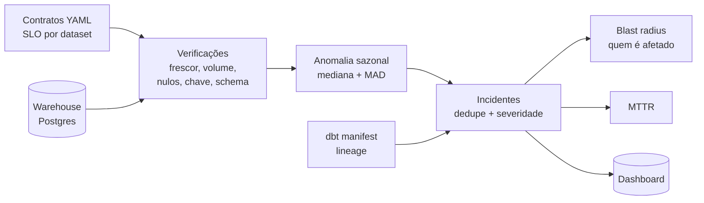

# Sentinela — confiabilidade de dados

[](https://github.com/ArthurTheWorld/sentinela/actions/workflows/ci.yml)


Plataforma de **confiabilidade de dados**: monitora contratos de SLO sobre datasets
analíticos, detecta anomalias com baseline sazonal, calcula o **alcance** de um
incidente pelo lineage do dbt e mede **MTTR** de ponta a ponta.

> A pergunta que este projeto responde: *"o dashboard executivo está errado —
> desde quando, por quê, e o que mais quebrou junto?"*

---

## O problema

Pipelines falham em silêncio. O dado chega, o dbt roda, o dashboard atualiza —
só que está errado: o volume caiu 70%, a coluna virou nula ou o schema mudou.
O time descobre pelo CFO, três dias depois.

Ferramentas de qualidade testam *linhas*. O que falta é **operação**:
contrato, detecção, incidente, alcance, tempo de resposta.

O Sentinela cobre esse ciclo:



---

## Como funciona

**1. Contrato por dataset** (`contracts/*.yml`) — declara dono, criticidade e os
limiares. Mudar um SLO é um PR revisável, não um número escondido no código.

```yaml
dataset: fct_vendas
tabela: analytics.fct_vendas
dono: time-vendas
critico: true
checks:
  freshness: { coluna: criado_em, aviso_apos: 2h, erro_apos: 6h }
  volume:    { coluna: criado_em, queda_aviso_pct: 30, queda_erro_pct: 60 }
  uniqueness: { colunas: [pedido_id, item_id] }
```

**2. Verificações** — 6 tipos: `freshness`, `volume`, `null_rate`, `uniqueness`,
`schema` e `custom` (SQL livre).

**3. Anomalia sazonal** — o volume de ontem é comparado com o mesmo dia da semana
das últimas 4 semanas (mediana + MAD), não com a média geral. Domingo vende
menos; isso não é incidente. Média e desvio-padrão seriam mascarados por um pico
de Black Friday.

**4. Incidente** — `ERROR` abre incidente; o mesmo problema dez vezes seguidas é
**um** incidente (fingerprint `dataset:check` + índice único parcial no banco).
`WARN` aparece no painel, mas não vira incidente: alerta demais é igual a alerta
nenhum.

**5. Blast radius** — o manifest do dbt diz quem depende de quem. Se `stg_pedidos`
quebra, a plataforma sabe que `fct_vendas` e `mart_receita_diaria` estão
comprometidos — e a severidade sobe com o alcance.

**6. MTTR** — ao recuperar, o incidente é resolvido automaticamente e o tempo
total (abertura → resolução) é registrado.

---

## Quickstart

Pré-requisito: Docker Desktop.

```powershell
docker compose up -d --build     # ou .\scripts\start.ps1
```

O script `start.ps1` sobe tudo, gera 60 dias de pedidos sintéticos (com
sazonalidade semanal), roda o dbt e executa a primeira verificação.

| Serviço | URL / acesso |
|---|---|
| Dashboard | http://localhost:8501 |
| Postgres | `localhost:5434` · `sentinela` / `sentinela` |

Depois disso, um **scheduler** roda `dbt run` + `sentinela run` a cada 15 minutos.

---

## Demonstração de incidente

O projeto inclui um **simulador de falhas** — porque confiabilidade não se
demonstra com tudo funcionando.

```powershell
.\scripts\demo-incidente.ps1
```

O roteiro:

1. Estado saudável (todas as verificações OK)
2. `apagao`: apaga ontem e hoje do banco operacional
3. `dbt run` + verificação → **dois incidentes**: volume zerado e dado defasado
4. Abre o dashboard → incidente aberto, severidade ALTA (alcance: 2 modelos)
5. `reparar`: recria o dataset
6. Verificação → incidentes **resolvidos**, MTTR calculado

Saída esperada no CLI:

```
=== 6. Incidentes (inclui resolvidos + MTTR) ===
SEV   DATASET    CHECK      STATUS      DURACAO           ALCANCE
ALTA  fct_vendas volume     resolvido   resolvido em 42s  mart_receita_diaria
```

Falhas disponíveis:

| Comando | O que quebra |
|---|---|
| `apagao` | volume + frescor |
| `defasagem` | frescor (só as últimas 12h) |
| `nulos` | taxa de nulos acima do limite |
| `duplicados` | unicidade da chave |
| `schema` | coluna não prevista no contrato |
| `reparar` | volta ao estado saudável |

```powershell
.\scripts\falha.ps1 apagao
```

---

## CLI

```
sentinela run                 # executa todos os contratos
sentinela status              # estado atual
sentinela incidentes --todos  # histórico + MTTR
sentinela alcance stg_pedidos # blast radius via lineage do dbt
```

---

## Estrutura

```
sentinela/
├── contracts/              # SLO por dataset (YAML)
├── sentinela/              # o produto
│   ├── contract.py         # parser e validação dos contratos
│   ├── checks.py           # 6 tipos de verificação
│   ├── anomalies.py        # mediana, MAD, baseline sazonal
│   ├── lineage.py          # grafo a partir do manifest do dbt
│   ├── incidents.py        # dedupe, severidade, ciclo de vida
│   ├── store.py            # persistência (meta.*)
│   ├── runner.py           # orquestra uma run
│   └── cli.py
├── dbt/                    # projeto monitorado (gera o lineage)
├── dashboard/app.py        # Streamlit
├── simulator/              # seed e injeção de falhas
├── docs/                   # ADRs e runbooks
└── tests/                  # pytest (sem banco)
```

---

## Testes

```powershell
python -m venv .venv
.\.venv\Scripts\Activate.ps1
pip install -r requirements.txt
pytest -q
```

O núcleo (contratos, anomalia, lineage, incidentes) é testado sem banco — a
decisão de projeto foi isolar o domínio do I/O.

---

## Decisões de design

| Decisão | Por quê |
|---|---|
| Contrato em YAML, versionado | SLO é acordo entre times, não configuração de ferramenta |
| Mediana + MAD | Resiste a outliers sazonais; média/desvio escondem queda |
| Fingerprint + índice único parcial | Deduplicação garantida pelo banco, não só pelo código |
| Só `ERROR` abre incidente | `WARN` no painel evita fadiga de alerta |
| Blast radius pelo manifest do dbt | Zero infraestrutura extra; trade-off documentado no ADR-004 |
| Simulador de falhas no repositório | Prova o valor com número, não com slide |

Discussão completa: [`docs/decisoes.md`](docs/decisoes.md).
Runbooks: [`docs/runbooks/`](docs/runbooks/).

---

## Roadmap

- [ ] OpenLineage/Marquez para lineage entre sistemas (não só dentro do dbt)
- [ ] Envio de incidentes para Slack/Teams com botão "reconhecer"
- [ ] Detecção de anomalia em schema (coluna que muda de tipo)
- [ ] Modo "dry-run" para validar contrato sem consultar o banco
- [ ] Exportar métricas para Prometheus/Grafana

---

## O que este projeto demonstra

- SLO de dados como contrato revisável, não como dashboard bonito
- Detecção com baseline sazonal (a parte estatística que a maioria ignora)
- Deduplicação de incidente e fadiga de alerta tratadas como requisito
- Lineage aplicado a impacto operacional (blast radius), não só a desenho
- MTTR como métrica de engenharia, medida de verdade
- Testes do domínio sem infraestrutura
